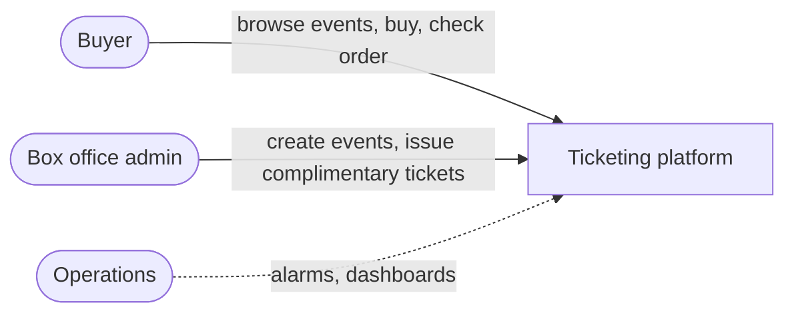
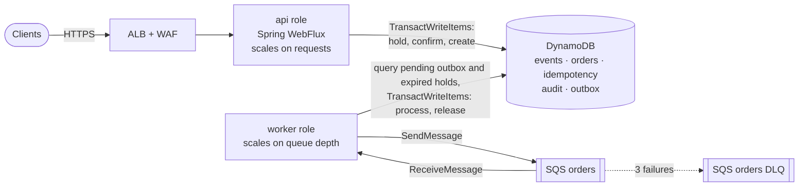
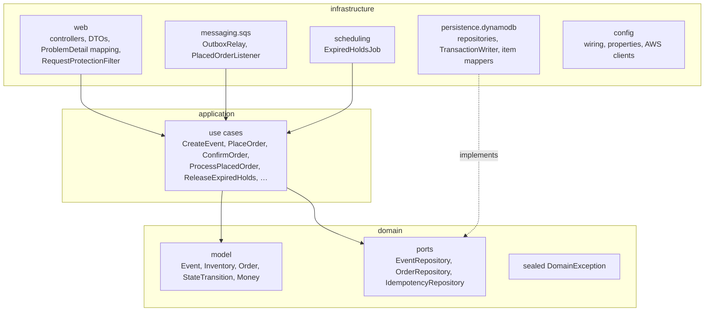
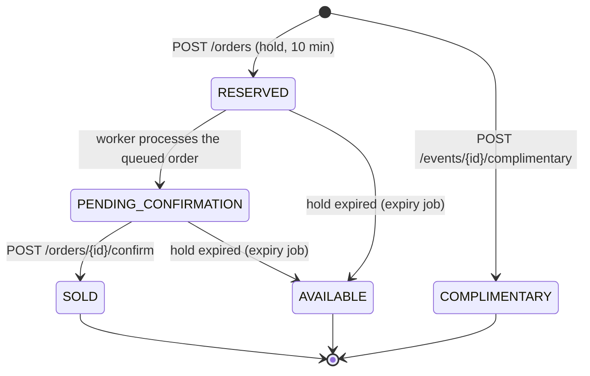
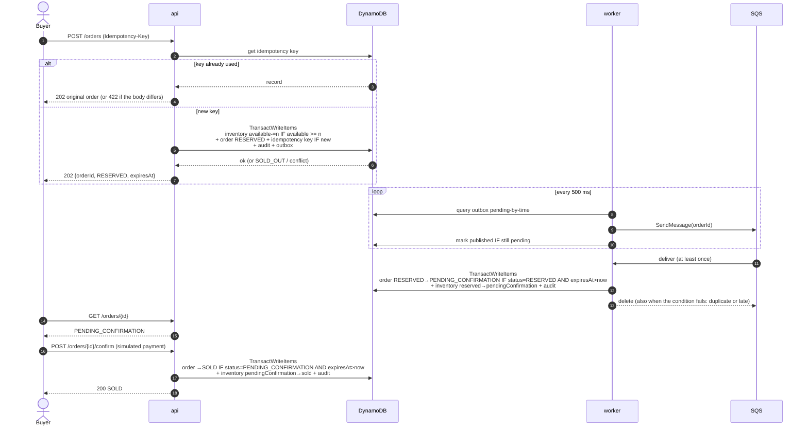
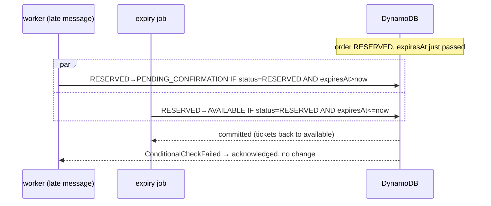

# Architecture

How the system is put together, from the outside in. Decisions and their alternatives are in
[`adr/`](adr); security controls in [`security/SECURITY.md`](security/SECURITY.md); the AWS deployment in
[`../infrastructure/terraform/README.md`](../infrastructure/terraform/README.md).

## 1. Context

Buyers hit the system all at once when popular tickets are released. The system has to answer fast, never
sell more tickets than exist, never sell the same ticket twice, and survive retries from impatient clients.

## 2. Containers

One image, two processes. Each runs one Spring profile and scales on its own signal.

| Role | Runs | Why separate |
|---|---|---|
| `api` | REST API, edge protection | Scales with traffic; never blocked by queue work |
| `worker` | Outbox relay, SQS listener, expiry job | Scales with backlog; the api keeps answering if the worker lags |

Locally both run from `docker-compose.yml` against DynamoDB Local and ElasticMQ (ADR 0005).

## 3. Code structure

Clean Architecture, enforced by `ArchitectureTest` (ArchUnit): the inner layers import no Spring, AWS,
Jakarta or Jackson; Reactor is allowed so ports can return `Mono`/`Flux`.

- **Domain** decides: `Order.place`, `startConfirmation`, `confirmSale`, `release` return a `StateTransition`
  (the new order, the inventory move, the audit step) or throw a domain exception. No I/O.
- **Application** orchestrates one use case each: load, ask the domain, hand the transition to a port.
- **Infrastructure** turns a transition into one `TransactWriteItems` with its conditions, and maps
  cancellation reasons back to domain exceptions.

## 4. Ticket and order states

- One deadline (`expiresAt = created + 10 min`) covers `RESERVED` and `PENDING_CONFIRMATION`, so a hold
  never exceeds the 10 minutes of RF2.
- `SOLD` and `COMPLIMENTARY` are final. `COMPLIMENTARY` has a zero amount and is not revenue.
- An order whose hold expired reports `AVAILABLE`: its tickets went back to the pool.
- The inventory keeps one counter per state, and every transition moves tickets between two counters in
  the same transaction: `available + reserved + pendingConfirmation + sold + complimentary = total`.

## 5. Purchase flow

Why hold in the request and validate in the consumer, instead of enqueueing first: ADR 0002.

## 6. Races, settled by conditions

There are no locks and no read-then-write. Every writer states what it expects in the condition, and
DynamoDB lets exactly one of them win.

| Race | Who wins | Tested in |
|---|---|---|
| 200 buyers, 50 tickets | Exactly 50 tickets held; the rest get `409 SOLD_OUT` | `DynamoDbOrderRepositoryIntegrationTest` |
| Same Idempotency-Key twice at once | One order; the other request is answered with it | `IdempotentReplayTest`, `DynamoDbOrderRepositoryIntegrationTest` |
| Consumer vs expiry at the deadline | One of them, never both | `DynamoDbOrderRepositoryIntegrationTest` |
| Confirm vs expiry | One of them. A confirm after the deadline gets `409 HOLD_EXPIRED`; one that loses the race at the deadline re-reads the order and returns its real state | `OrderTest`, `OrderUseCasesTest` |
| Duplicate SQS delivery | First one; the copy fails the condition and is acknowledged | `PurchaseFlowIntegrationTest` |

Transient conflicts between transactions (`TransactionConflict`, throttling) are retried with jittered
backoff; a failed condition never is.

## 7. Data model

| Table | PK | SK | Index | Item |
|---|---|---|---|---|
| events | `EVENT#<id>` | `METADATA` | `events-by-date` (`listingKey`=`EVENT`, `eventDate`) | Name, venue, date, capacity, price |
| events | `EVENT#<id>` | `INVENTORY` | — | One counter per state: the hot item under a flash sale |
| orders | `ORDER#<id>` | — | `holds-by-expiry` (`holdStatus`, `expiresAt`), sparse | Order, status, amount, `expiresAt` |
| idempotency | `IDEMPOTENCY#<scope>#<key>` | — | — | Request hash, resource id; TTL 24 h |
| audit | `ORDER#<id>` | `<epoch ms>#<step>#<state>` | — | One item per transition, in lifecycle order |
| outbox | `OUTBOX#OrderPlaced#<orderId>` | — | `pending-by-time` (`pendingKey`, `createdAt`), sparse | Message to publish; TTL 24 h once published |

Access patterns:

| Pattern | How |
|---|---|
| List upcoming events | Query `events-by-date` |
| Event, availability | Get `METADATA` / `INVENTORY` |
| Order by id | Get `ORDER#<id>` |
| Expired holds | Query `holds-by-expiry` for `RESERVED` and `PENDING_CONFIRMATION` with `expiresAt <= now`. Sparse: an order drops out of the index when it stops holding tickets, so the job reads only live holds |
| Unpublished messages | Query `pending-by-time`. Sparse: publishing removes `pendingKey` |
| Audit trail of an order | Query `ORDER#<id>` in the audit table |

Numbers that sort (dates, deadlines) are stored as epoch milliseconds (`N`); money as a decimal string,
read back into `BigDecimal`.

## 8. Resilience and load

| Concern | Mechanism |
|---|---|
| Overload | Rate limits per user and address (`429`), cap on requests in flight (`503 OVERLOADED`), both before any write |
| Slow datastore | SDK timeouts (500 ms per attempt, 2 s per call); a client-side failure answers `503 TIMEOUT`: retry with the same key |
| Message loss | Outbox written in the order's transaction; SQS at least once; DLQ after 3 failures |
| Duplicate work | Conditional transitions everywhere; several workers can run the relay and the expiry job |
| Health checks | Readiness is shallow, so a slow DynamoDB cannot drain every instance at once |

Measured behaviour under a flash sale, and the fixes it led to: [`../load-test/RESULTS.md`](../load-test/RESULTS.md).

## 9. Notable choices

- **Reactive end to end, no virtual threads.** WebFlux on Netty with the AWS SDK's async client: no thread
  waits for I/O, so virtual threads would add nothing.
  Java 25 shows up where it helps: records for the model and DTOs, a sealed exception hierarchy with an
  exhaustive `switch` for error mapping, and unnamed variables in patterns.
- **Conditional writes, not version numbers.** The condition is the invariant itself
  (`available >= :n`, `status = :from`), so concurrent buyers never fail just because another buyer
  changed an unrelated field.
- **No circuit breaker around DynamoDB** (ADR 0004): there is no fallback, and sold-out bursts would look
  like failures.
- **Authentication out of scope** (ADR 0003), behind one interface.
